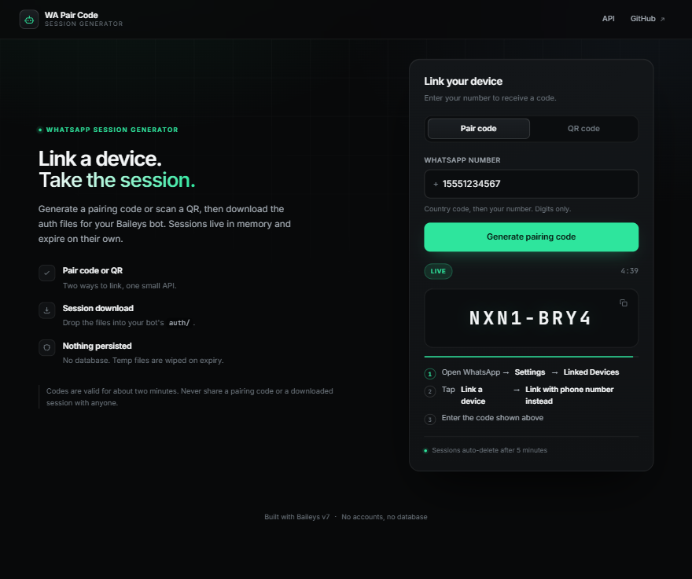

# WhatsApp AI Bot

A secure, modular WhatsApp bot built on **[@whiskeysockets/baileys v7](https://github.com/WhiskeySockets/Baileys)** for Node.js 20+.

It links to WhatsApp the same way WhatsApp Web does, then answers **34 commands** across five categories — general info, group administration, link moderation, tools, and an optional AI layer that talks to a model running on *your* machine.


---

## Contents

- [What you get](#what-you-get)
- [Requirements](#requirements)
- [Quick start](#quick-start)
- [Linking your WhatsApp](#linking-your-whatsapp)
- [Running it properly](#running-it-properly)
- [Command reference](#command-reference)
- [Configuration](#configuration)
- [AI setup](#ai-setup)
- [Tests and CI](#tests-and-ci)
- [Project layout](#project-layout)
- [Troubleshooting](#troubleshooting)
- [Security model](#security-model)
- [License](#license)

---

## What you get

| Area | What it does |
|---|---|
| **General** | `.ping` `.alive` `.uptime` `.menu` `.owner` `.quote` `.groupinfo` `.admins` `.rules` |
| **Group admin** | `.kick` `.promote` `.demote` `.tagall` `.group` `.setname` `.setdesc` `.delete` |
| **Moderation** | `.antilink` with a domain whitelist · `.welcome` and `.goodbye` templates per group |
| **Tools** | `.weather` `.calc` `.define` `.qr` `.shorten` `.sticker` — all on free, keyless APIs |
| **Fun** | `.joke` `.fact` |
| **AI (optional)** | `.ai` `.code` `.explain` `.summarize` `.translate` via Ollama or any OpenAI-compatible gateway |
| **Engine** | Session persistence, reconnect with backoff + jitter, graceful shutdown, structured redacted logs, per-user rate limits, offline test suite |

Design rules the code actually follows:

- **Authorization is central.** Admin / owner / bot-admin are decided in one place (`src/permissions.js`) before any command body runs. Identity comes from WhatsApp metadata, never from text a user typed.
- **LID-safe.** WhatsApp now identifies members with either phone-number JIDs (`…@s.whatsapp.net`) or opaque LIDs (`…@lid`). Both are handled, and owner spoofing is not possible.
- **Nothing dangerous is automatic.** The bot never kicks or bans on its own. Destructive actions require an admin to invoke them.
- **Logs are redacted.** No credentials, no keys, no QR payloads, no message bodies.

---

## Requirements

| | |
|---|---|
| **Node.js** | 20 or newer (`node --version`). Node 22 LTS recommended. |
| **npm** | 9+ (ships with Node) |
| **WhatsApp** | An account you are willing to link as a companion device |
| **Optional** | [Ollama](https://ollama.com) or an OpenAI-compatible gateway (FreeLLMAPI, LM Studio, vLLM) for the AI commands |

> **Use responsibly.** This project uses an unofficial library and is not affiliated with WhatsApp or Meta. No spam, no bulk messaging, no unsolicited marketing.

---

## Quick start

### 1. Clone

```bash
git clone https://github.com/inyogeshwar/whatsapp-ai-bot.git
cd whatsapp-ai-bot
```

### 2. Install

```bash
npm install
```

### 3. Configure

```bash
# macOS / Linux
cp .env.example .env

# Windows (PowerShell)
Copy-Item .env.example .env
```

Open `.env` and set at least your own number, so owner-only commands work:

```dotenv
BOT_OWNER_NAME=Your Name
BOT_OWNER_JID=15551234567        # digits + country code, no + or spaces
BOT_NAME=My WhatsApp Bot
```

Every other value has a safe default. `.env` is git-ignored — **never commit it**.

### 4. Link WhatsApp

See [Linking your WhatsApp](#linking-your-whatsapp) below — QR or pairing code, your choice.

### 5. Start

```bash
npm start
```

You should see:

```
✔ connected to WhatsApp
🚀 My WhatsApp Bot is online
```

Send `.ping` from another phone (or from a group) to check it.

> **Note:** the bot runs *on* your number, so messages you send yourself are ignored on purpose — WhatsApp delivers them as "from me". Test commands from a **second number** or from a group where the bot is a member.

---

## Linking your WhatsApp

Session credentials live in `auth/`. The bot writes them there on first login and reuses them forever after, so you only link once.

You can also put a local image of the QR on disk — handy on a VPS:

```dotenv
LOGIN_METHOD=qr
QR_IMAGE_PATH=qr.png      # git-ignored, deleted automatically after login
```

### Option A — QR code in the terminal (default)

```dotenv
LOGIN_METHOD=qr
```

```bash
npm start
```

A QR is printed in your terminal. On your phone: **WhatsApp → Settings → Linked Devices → Link a Device**, then scan it directly off the screen.

> The QR is rendered only in your local terminal. Never screenshot or share it — it grants full access to the account.

### Option B — Pairing code (more stable)

QR re-scans are the usual cause of `device_removed` (401) logouts. A pairing code avoids that entirely: you type 8 characters once, in WhatsApp, and the bot stores the session.

```dotenv
LOGIN_METHOD=pairing
PAIRING_NUMBER=15551234567     # digits + country code, no + or spaces
```

```bash
npm start
```

The terminal prints a code like `ABCD-EFGH`. On your phone: **WhatsApp → Settings → Linked Devices → Link a Device → Link with phone number instead**, then type the code. It is valid for about two minutes; if it expires, restart the bot.

### Option C — Pair from a web page (no terminal needed)

If you'd rather not touch `.env` or sit in front of a terminal, the companion project **[WA Pair Code](https://github.com/inyogeshwar/wa-pair-code)** does the same thing through a small web UI: open the page, type your number, get the code, enter it, download the session zip, and drop the `.json` files into `auth/`.


It is a separate, self-hostable service (Node + Baileys, no database). Run it locally or deploy it free on Render — the repo has a `render.yaml` and a `Dockerfile` ready to go.



---

## Running it properly

`npm start` is fine while you're watching the terminal. On a server you want it to survive disconnects and restarts.

### Supervisor script (built in)

```bash
npm run keep-alive
```

Restarts the bot if it crashes and exits cleanly (code `2`) when the session is permanently gone — for example after you unlink the device from your phone. That signal is deliberate: restarting forever on a dead session just spams logs.

### pm2 (recommended on a VPS)

```bash
npm install -g pm2
pm2 start npm --name whatsapp-ai-bot -- run keep-alive
pm2 save
pm2 startup          # follow the printed command to enable boot start
pm2 logs whatsapp-ai-bot
```

### systemd

```ini
# /etc/systemd/system/whatsapp-ai-bot.service
[Unit]
Description=WhatsApp AI Bot
After=network-online.target

[Service]
WorkingDirectory=/opt/whatsapp-ai-bot
ExecStart=/usr/bin/node scripts/keep-alive.js
Restart=always
RestartSec=5
Environment=NODE_ENV=production

[Install]
WantedBy=multi-user.target
```

```bash
sudo systemctl enable --now whatsapp-ai-bot
sudo journalctl -u whatsapp-ai-bot -f
```

### Docker

The repo ships a `Dockerfile`:

```bash
docker build -t whatsapp-ai-bot .

# QR login — mount auth/ so the session survives container restarts
docker run -d --init --name wa-bot \
  -v "$PWD/auth:/app/auth" \
  -v "$PWD/data:/app/data" \
  --env-file .env \
  --restart unless-stopped \
  whatsapp-ai-bot
```

With `LOGIN_METHOD=pairing` you can skip the QR entirely: set `PAIRING_NUMBER` in `.env`, start the container, read the code from `docker logs -f wa-bot`, and enter it on your phone.

### Where it can and cannot run

| Host | Works? | Why |
|---|---|---|
| Your PC / laptop | ✅ | Easiest for a first test |
| VPS (DigitalOcean, Hetzner, Oracle free tier…) | ✅ | Best for 24/7 uptime |
| Raspberry Pi | ✅ | Low power, but keep it on a stable network |
| Railway / Fly.io / Render | ⚠️ | Works, but free tiers sleep and reset disks — mount a volume for `auth/` |
| Vercel / Netlify / Cloudflare Workers | ❌ | Serverless cannot hold the long-lived WebSocket Baileys needs |

---

## Command reference

Prefix is `.` by default (`BOT_PREFIX`). Aliases are in parentheses.

### General — anyone

| Command | What it does |
|---|---|
| `.ping` (`p`) | Response time |
| `.alive` (`status`) | Bot name, uptime, Node and bot version |
| `.uptime` (`up`) | How long the process has been running |
| `.menu` (`help`) | The full category list (AI commands appear only when AI is enabled) |
| `.owner` (`creator`) | Owner's name and contact |
| `.quote` (`motivate`, `shayari`) | A random quote |
| `.groupinfo` (`ginfo`) | Name, description, member count, admins — *groups only* |
| `.admins` (`adminlist`) | Mention the group administrators — *groups only* |
| `.rules` (`rule`) | Group rules. Admins can also run `.rules set <text>` and `.rules clear` |

### Group administration — group admins and the owner

| Command | What it does |
|---|---|
| `.tagall [message]` (`everyone`, `all`) | Mention every member — live member list, batched for big groups, per-group cooldown |
| `.kick @user` (`remove`) | Remove a member (replying to them works too) |
| `.promote @user` | Make a member an admin |
| `.demote @user` | Demote an admin |
| `.group open` / `.group close` (`gmode`) | Everyone can message / admins only |
| `.setname <name>` (`subject`) | Rename the group |
| `.setdesc <text>` (`desc`) | Change the group description |
| `.delete` (`del`) | **Reply to** a message to delete it for everyone — the bot must be admin |

### Moderation

| Command | What it does |
|---|---|
| `.antilink on` / `.antilink off` | Toggle link moderation in this group |
| `.antilink status` | Current configuration |
| `.antilink allow add <domain>` | Whitelist a domain (subdomains included) |
| `.antilink allow remove <domain>` | Remove a whitelisted domain |
| `.antilink allow list` | Show the whitelist |
| `.welcome on` / `.welcome off` / `.welcome status` | Welcome message for new members |
| `.welcome set <template>` | e.g. `Welcome {user} to {group}!` — also enables it |
| `.goodbye on` / `.goodbye off` / `.goodbye status` | Goodbye message for members who leave |
| `.goodbye set <template>` | e.g. `Goodbye {user} 👋` |

**Templates:** `{user}` mentions the member, `{group}` is the group name.

**Anti-link behaviour:** messages are deleted when the bot is an admin (with a short warning); otherwise it only warns. Admins and the owner are exempt, links from whitelisted domains are allowed, and members are **never** kicked automatically.

### Tools

| Command | What it does |
|---|---|
| `.weather <city>` (`mausam`, `w`) | Current weather — Open-Meteo, no key |
| `.calc <expression>` (`math`, `calculate`) | e.g. `.calc sqrt(144) + 2^10` |
| `.define <word>` (`dict`, `meaning`) | English dictionary lookup |
| `.qr <text or url>` (`qrcode`) | Render text or a link as a QR image |
| `.shorten <url>` (`short`, `tiny`) | Shorten a long link |
| `.sticker` (`s`, `stiker`) | Reply to an image, or pass an image URL, to get a sticker |

Turn every network command off with `WEB_ENABLED=false`. Sticker size is capped by `STICKER_MAX_BYTES` (default 2 MB).

### Fun

| Command | What it does |
|---|---|
| `.joke` (`jokes`, `hasao`) | A random joke |
| `.fact` (`facts`, `gyan`) | A random fact |

### AI — optional, needs a model

| Command | What it does |
|---|---|
| `.ai <question>` (`ask`, `gpt`) | Ask the configured model |
| `.ai models` | List the model ids the backend offers — use this to pick `AI_MODEL` |
| `.code <language> <task>` (`dev`) | Ask for a short code snippet |
| `.explain <topic>` (`eli5`) | Explain something simply — reply to a message to explain that |
| `.summarize <text>` (`summary`, `sum`) | Summarise a long message, or reply to one |
| `.translate <language> <text>` (`tr`) | Translate text |

If AI is off or unreachable, **everything else keeps working** — the AI commands are simply hidden from `.menu` and reply with an honest error.

---

## Configuration

All settings live in `.env`. Invalid values fail fast at startup with a message naming the variable.

### Bot identity

| Variable | Default | Meaning |
|---|---|---|
| `BOT_NAME` | `My WhatsApp Bot` | Shown in `.alive` and `.menu` |
| `BOT_OWNER_NAME` | `Bot Owner` | Shown in `.owner` |
| `BOT_OWNER_JID` | *(empty)* | **Recommended.** Your ID — `15551234567`, `15551234567@s.whatsapp.net`, or a `…@lid`. Leave empty to disable owner-only features |
| `BOT_PREFIX` | `.` | Command prefix (single character) |
| `LOG_LEVEL` | `info` | `trace` \| `debug` \| `info` \| `warn` \| `error` \| `fatal` \| `silent` |

### Login

| Variable | Default | Meaning |
|---|---|---|
| `LOGIN_METHOD` | `qr` | `qr` or `pairing` |
| `PAIRING_NUMBER` | *(empty)* | Required when `LOGIN_METHOD=pairing` |
| `QR_IMAGE_PATH` | *(empty)* | Optional path for a QR image file (`qr` login only). Deleted after login |

### Network tools

| Variable | Default | Meaning |
|---|---|---|
| `WEB_ENABLED` | `true` | Master switch for `.weather` `.define` `.shorten` |
| `WEB_TIMEOUT_MS` | `15000` | Per-request timeout |
| `STICKER_MAX_BYTES` | `2000000` | Largest image accepted by `.sticker` |
| `STICKER_AUTHOR` / `STICKER_PACK` | | Sticker metadata |

### AI

| Variable | Default | Meaning |
|---|---|---|
| `AI_ENABLED` | `false` | Turn the AI commands on |
| `AI_PROVIDER` | `ollama` | `ollama` or `openai` (any OpenAI-compatible gateway) |
| `AI_BASE_URL` | `http://127.0.0.1:11434` | Endpoint, e.g. `http://127.0.0.1:31415` for FreeLLMAPI |
| `AI_API_KEY` | *(empty)* | Required for `AI_PROVIDER=openai`; never committed |
| `AI_MODEL` | *(empty)* | Required when AI is enabled |
| `AI_MAX_INPUT` / `AI_MAX_OUTPUT` | `2000` / `4000` | Character bounds |
| `AI_TIMEOUT_MS` | `30000` | Request timeout |
| `AI_RATE_LIMIT` / `AI_RATE_WINDOW_SEC` | `5` / `60` | AI requests per user per window |

### Limits

| Variable | Default | Meaning |
|---|---|---|
| `CMD_RATE_LIMIT` / `CMD_RATE_WINDOW_SEC` | `8` / `10` | Commands per user per window |
| `TAGALL_COOLDOWN_SEC` | `60` | Per-group `.tagall` cooldown |

---

## AI setup

Two providers, picked with `AI_PROVIDER`. Neither is required — the bot is fully useful without AI.

### Ollama (local, private)

```dotenv
AI_ENABLED=true
AI_PROVIDER=ollama
AI_BASE_URL=http://127.0.0.1:11434
AI_MODEL=llama3.2
```

```bash
ollama pull llama3.2
ollama serve
```

### Any OpenAI-compatible gateway

Works with FreeLLMAPI, LM Studio, vLLM, `llama.cpp --api`, or OpenAI itself.

```dotenv
AI_ENABLED=true
AI_PROVIDER=openai
AI_BASE_URL=http://127.0.0.1:31415
AI_API_KEY=your-gateway-key
AI_MODEL=gemini-3.5-flash
```

Restart the bot, send `.ai models` to see which ids the gateway actually serves, then `.ai What is Node.js?`.

**Privacy:** only the exact text you typed is sent to the model. Never chat history, never credentials. The API key stays in `.env`, is sent only to your configured `AI_BASE_URL`, and is never logged.

---

## Tests and CI

```bash
npm test
```

**89 tests, offline, no WhatsApp account needed** — the socket and group metadata are fully mocked. Covered: command parsing and aliases, text extraction (including wrapped messages), permission checks with LID/PN identities and owner-spoofing resistance, missing quoted messages, URL detection and domain whitelisting, anti-link actions and dedupe, rate limits and cooldowns, welcome/goodbye templates and suppression, settings persistence (atomic writes + corrupt-file recovery), and the whole dispatch pipeline.

GitHub Actions runs the suite on Node 20 and 22 for every push — see [`.github/workflows/ci.yml`](.github/workflows/ci.yml).

---

## Project layout

```text
src/
├── index.js               entry point & shutdown wiring
├── config.js              .env loading + validation
├── logger.js              pino logging with redaction
├── connection.js          socket lifecycle, QR / pairing login, reconnect
├── handler.js             message pipeline: filter → moderate → parse → gate → dispatch
├── message-parser.js      text extraction & command parsing (pure functions)
├── command-registry.js    command lookup + aliases
├── permissions.js         LID-safe admin / owner / bot-admin checks
├── group-settings.js      persistent per-group config (atomic JSON writes)
├── rate-limiter.js        rate limits, cooldowns, dedupe sets
├── utils/                 jid · text · group · message helpers
├── commands/              one file per command — general/ · admin/ · tools/ · fun/ · ai/
└── services/              welcome · moderation · tools · ai · metadata cache

scripts/keep-alive.js      crash supervisor (exit 2 = session permanently gone)
data/group-settings.json   per-group preferences (git-ignored, safe to back up)
auth/                      your session credentials (git-ignored, NEVER back up or share)
```

The only file that touches `makeWASocket` is `src/connection.js`, so swapping the file-based auth store for a database is a contained change.

See [ARCHITECTURE.md](./ARCHITECTURE.md) for the full design and [PRD.md](./PRD.md) for the product spec.

---

## Troubleshooting

| Symptom | Cause & fix |
|---|---|
| `Session was logged out…` on startup | Your phone unlinked the device. Delete `auth/`, run `npm start`, link again. |
| Reconnects in a loop | Unstable network or WhatsApp-side issues. The bot retries 8 times with backoff, then stops and says so — restart it. |
| Commands do nothing | You're testing from the bot's own number. WhatsApp marks those messages as "from me" and the bot ignores them — use a second number or a group. |
| `.ai` unreachable | Start the backend (`ollama serve`, or your gateway) and re-check `AI_BASE_URL`. |
| `.ai` says the model is missing | Ollama: `ollama pull <model>`. Gateway: compare the id against `.ai models`. |
| `.ai` returns an auth error | `AI_PROVIDER=openai` needs a valid `AI_API_KEY`. |
| `⏳ You are sending commands too quickly` | Per-user rate limit — wait a few seconds, or raise `CMD_RATE_LIMIT`. |
| `⛔ This command is for group administrators only` | You aren't an admin or the owner in that group. |
| `⛔ I need to be a group administrator` | Promote the bot's account in that group, then retry. |
| `.kick` / `.delete` fails | WhatsApp only lets admins remove members or delete others' messages — check both your role and the bot's. |
| Someone can't be mentioned or kicked | Usually an `@lid` identity, or the target already left the group. Both id forms are handled; make sure the bot outranks them. |
| Settings seem to reset | `data/group-settings.json` was deleted or corrupted. The bot falls back to defaults and logs a warning. |
| `ConfigError` at startup | A `.env` value is invalid — the message names the variable and the allowed values. |

---

## Security model

- **Secrets live only in `.env` and `auth/`.** Both are git-ignored. Nothing is hardcoded.
- **Logs are structured (pino) with redaction** — no credentials, keys, QR payloads, or message bodies.
- **Authorization is checked centrally** before any command body runs, and targets come only from WhatsApp-provided metadata — never from user-typed JIDs.
- **Rate limits** apply per user and per group; `.tagall` has its own cooldown and batch cap.
- **No shell, no `eval`, no retained conversation history.**
- **No automatic destructive actions.** Moderation deletes or warns; it never bans.
- **Backups:** `data/` is safe to back up (group preferences only). **`auth/` is not** — never put it in a repo, a shared drive, or a chat.

If a session is compromised, unlink the device in **WhatsApp → Linked Devices**, delete `auth/`, and link again.

---

## License

MIT — see [LICENSE](./LICENSE). Use it on your own number, responsibly.
